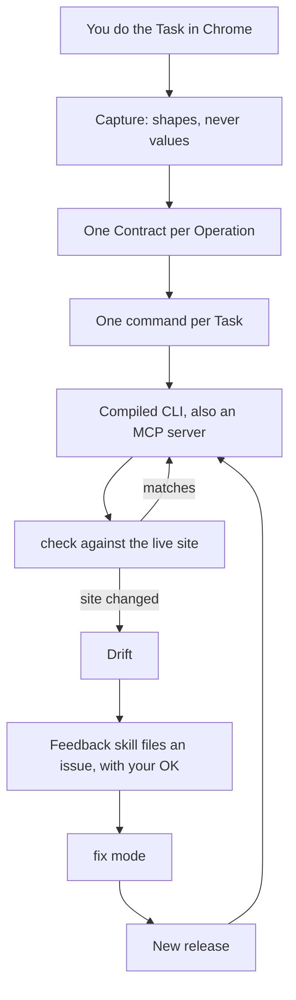

# site-cli-creator

Teach your coding agent a website: do each task once in Chrome, get a plugin of small CLIs that check themselves.

[](https://github.com/hoaj/site-cli-creator/actions/workflows/site-cli-creator.yml)
[](./LICENSE)
[](./plugins/site-cli-creator/.claude-plugin/plugin.json)

site-cli-creator is a generator for coding agents (Claude Code, GitHub Copilot CLI, Cursor). It turns the calls a website's own frontend makes into a plugin of compiled [Bun](https://bun.sh) CLIs, and your agent runs them signed in as you. Every CLI is also an MCP server: locally (`mcp`), or hosted for one person (`mcp --http`). Each plugin notices when the site changes (Drift) and, with your OK, files an issue its maintainer fixes with the generator's `fix` mode.

## Demo

Using a generated plugin ([logbuy](#example-logbuy)). Abridged.

```text
you    > Is there a LogBuy deal on headphones?
agent  > $ logbuy deal search "headphones"
         {
           "total": 3,
           "deals": [
             { "shop": "…", "discount": "15 - 50 %", "minPercent": 15, "maxPercent": 50,
               "offer": { "title": "…", "timeLeft": "…" }, "url": "https://www.mylogbuy.com/partner/…" },
             …
           ]
         }
agent  > Yes, 3 shops have a LogBuy deal on headphones. The best is up to 50 % off at …
```

Creating one. Abridged.

```text
you    > Make me a plugin for mylogbuy.com. I want to search deals, see one
         shop's deal, and list the categories.
agent  > Prerequisites ok (Bun, Chrome, gh, admin on the repo).
         Capture: Chrome opens. Search for a deal as you normally would.
agent  > Task 1: "search deals for a product"
           command: deal search <query>
           output:  total: number
                    deals: [{shop: string, discount: string, minPercent: number,
                             maxPercent: number, offer: {...} | null, url: string}]
           uses:    GET /api/search/suppliers   (dropped: 3, with reasons)
           effect:  read
         Accept, edit, or skip?
you    > Accept.
agent  > Generating Contracts and commands, then `logbuy check --writes` ... ok
         Pushing to main; the release workflow builds five binaries.
```

## When to use it, and when not

Use it when a site has no API you can use, you use it often, and you want an agent to do it as you.

Do not use it when:

- the site has an official API. Use that.
- you want to scrape at scale.
- the account belongs to someone else.
- the site sits behind a bot wall such as a Cloudflare challenge or captcha. [SPEC.md](./SPEC.md#11-out-of-scope) lists this as out of scope.

## Quickstart

Prerequisites: [Bun](https://bun.sh) 1.4 or newer, Google Chrome, the [GitHub CLI](https://cli.github.com) logged in (`gh auth login`), and a GitHub repo you administer. The repo is public by default so users install your plugin without `gh`.

Install the generator.

Claude Code:

```text
/plugin marketplace add hoaj/plugins
/plugin install site-cli-creator@hoaj
```

GitHub Copilot CLI:

```sh
copilot plugin marketplace add hoaj/plugins
copilot plugin install site-cli-creator@hoaj
```

Cursor: Settings, Plugins, Add marketplace, `hoaj/site-cli-creator`, then install **site-cli-creator**. Cursor's marketplaces cannot list a plugin from another repo, so this repo has its own.

Then paste one prompt to your agent, with your site in place of the example:

```text
Make me a plugin for https://www.mylogbuy.com. I want to search deals, show one shop's deal, and list the categories.
```

The plugin gets its own repo (`new --dir`) or a folder in a marketplace repo you already have, like [hoaj/plugins](https://github.com/hoaj/plugins) (`new --into`). The agent asks which.

## How it works



The terms, defined in [CONTEXT.md](./CONTEXT.md):

- **Task**: something you want an agent to do on a site, in plain words. It becomes one command, `<noun> <verb>`.
- **Capture**: a recording of the calls the frontend makes while you perform one Task, kept as shapes (field names and types) with no values.
- **Operation**: one distinct call to the site, a method plus path for REST or an `operationName` for GraphQL.
- **Contract**: what the CLI expects from one Operation: its request and the shape of only the response fields the CLI reads.
- **Drift**: a failure caused by the site having changed away from a Contract, as opposed to a session, network or input failure.

## Modes

| Mode | Use it when | Guide |
|---|---|---|
| `new` | a new site and no plugin yet | [reference/new.md](./plugins/site-cli-creator/skills/site-cli-creator/reference/new.md) |
| `add-skill` | another site or login in an existing plugin | [reference/add-skill.md](./plugins/site-cli-creator/skills/site-cli-creator/reference/add-skill.md) |
| `add-task` | a new Task, or a `feature` issue | [reference/add-task.md](./plugins/site-cli-creator/skills/site-cli-creator/reference/add-task.md) |
| `fix` | a Drift or `bug` issue from the plugin's Feedback skill | [reference/fix.md](./plugins/site-cli-creator/skills/site-cli-creator/reference/fix.md) |

Every mode reads [reference/contracts.md](./plugins/site-cli-creator/skills/site-cli-creator/reference/contracts.md) before it writes an Operation.

## Example: logbuy

[logbuy](https://github.com/hoaj/plugins/tree/main/plugins/logbuy) reads employee-benefit deals on mylogbuy.com. Its commands are `deal search`, `deal show`, `deal browse` and `category list`, plus the built-ins `login`, `check`, `doctor` and `mcp`. It lives in [hoaj/plugins](https://github.com/hoaj/plugins), and the [catalog](https://hoaj.github.io/plugins/) shows each plugin's daily check status, so you can see when a site has drifted.

## Privacy, safety and site terms

- Captures keep shapes (field names and types), never values.
- Sessions stay on your machine, in `~/.<plugin>/`, with file mode 0600.
- Issues are drafted from shapes only, and filed only after you say yes.
- Reads never write, and `check` never sends writes.
- Each plugin acts as one person, with their own login.

Read and respect each site's terms of service. Use plugins only with your own accounts. A plugin sends the same kind of requests the site's frontend does, but whether that is allowed depends on the site. This is not legal advice.

Report security problems privately; see [SECURITY.md](./SECURITY.md).

## FAQ

**How is this different from browser automation like Playwright or browser-use?**
A generated CLI makes the site's own API calls directly, compiled, and checks them against Contracts. Chrome is used for sign-in and for write checks, not for every run.

**What happens when the site changes?**
`check` or a normal run fails with a Drift error. The plugin's Feedback skill drafts an issue from shapes only and files it after you agree. The maintainer runs `fix`, which re-captures the Task, corrects the Contract and releases a patch.

**Which agents does it work with?**
Claude Code, GitHub Copilot CLI and Cursor. Any MCP client can use a generated CLI through `mcp`.

**Can I use a plugin from claude.ai or my phone?**
Yes, for one person: run the CLI as `mcp --http` on a host you control. The plugin's Deploy skill walks you through it.

**Does it work on Windows?**
Yes. Releases include binaries for darwin-arm64, darwin-x64, linux-x64, linux-arm64 and windows-x64, and the install script runs in Git Bash.

**Is it allowed?**
That depends on the site's terms. See the privacy and site terms section above.

## Documentation

- [SPEC.md](./SPEC.md): what the generator does and why.
- [CONTEXT.md](./CONTEXT.md): the glossary.
- [ARCHITECTURE.md](./plugins/site-cli-creator/ARCHITECTURE.md): where things live and the interfaces between them.
- [SKILL.md](./plugins/site-cli-creator/skills/site-cli-creator/SKILL.md) and its [reference docs](./plugins/site-cli-creator/skills/site-cli-creator/reference): what the agent follows.

The plugin itself is [site-cli-creator](./plugins/site-cli-creator). Skills for changing the generator are in [maintainer-skills/](./maintainer-skills).

## Contributing

See [CONTRIBUTING.md](./CONTRIBUTING.md). For a problem with the generator, use the `site-cli-creator-feedback` skill, or open an issue labelled `site-cli-creator`.

## License

[MIT](./LICENSE)
